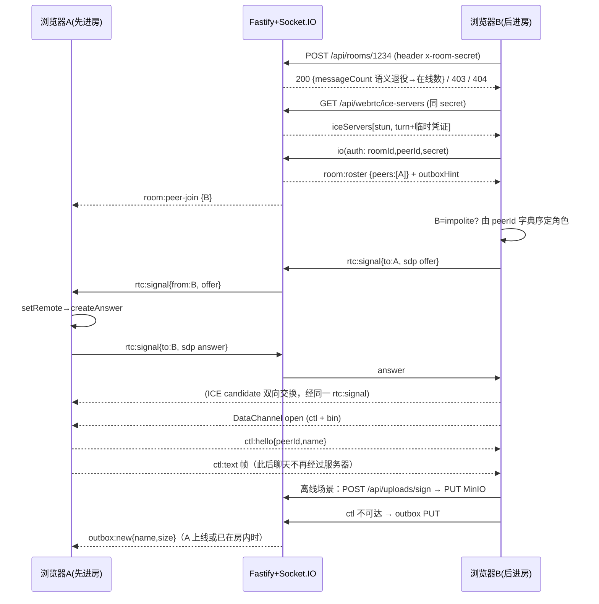

# 10 · P2P 聊天方案（WebRTC）

> 本轮修订的核心文档：聊天数据面从「服务器中转 + Redis 存历史」改为
> **WebRTC DataChannel 端到端直传**。03/04/05/06/07/08/09 的相关章节已同步，
> 本文给出完整设计、选型依据、时序、协议、运维与安全。

## 1. 决策与范围

| 决策 | 内容 |
|---|---|
| 数据面 | 文本与文件在两个（至多 mesh 上限个）浏览器之间经 DataChannel 直传，**不经过服务器** |
| 控制面 | Socket.IO 继续同端口承担：信令转发、成员在线、房间注册/secret 校验、降级中继、离线文件回执通知 |
| 消息持久化 | 服务器**不再存储聊天消息**。历史 = 各设备本地 IndexedDB（跨设备不同步，产品权衡见 §10） |
| MinIO 的角色 | 保留：大文件（> 阈值）、对端离线时的"上传-回执-领取"、图片 URL 直贴（现状行为） |
| 降级 | P2P 打不通（对称 NAT 且无 TURN）→ relay 模式经 Socket.IO 转发（不落库、UI 标注） |

**产品语义变化（必须向使用方明示）**：

1. 对方不在线时**文本发不出去**（原服务器代收不再存在）——UI 以在线状态 +
   「对方未在线」提示承接。
2. **换设备看不到旧消息**（历史不上传）。
3. 旧分享链接（无邀请密钥）不能进新房间：4 位房间号 + secret 双重校验，
   老房间随 30 天 TTL 自然消亡，不做兼容孔。

## 2. 库选型对比（"WebRTC 或开源库都行"的评估结论）

| 方案 | 说明 | 结论 |
|---|---|---|
| **原生 `RTCPeerConnection` + 自有信令（本方案）** | 浏览器 API 直用；信令走已定稿的 Socket.IO 同端口通道；约 300 行传输层代码 | ✅ 采用：零新增运行时依赖、鉴权/审计/排错全自持 |
| simple-peer | 单连接封装，API 简单；多人 mesh、替换协商（glare）、事件粒度都要自己补；维护节奏一般 | ❌ 收益 < 黑盒成本 |
| trystero | **去服务器**信令（BitTorrent DHT / Nostr / MQTT 公共基础设施撮合），连我们自己的 signaling 都不要 | ❌ 依赖公网基建，私有部署/审计/连通性不可控；且我们已有同端口通道，省不了多少 |
| PeerJS | 默认依赖 PeerServer 公共云；自托管 broker 需再开一个服务 | ❌ 违背单进程端口定稿 |
| Matrix (matrix-js-sdk) / LiveKit | 完整 IM 协议 / SFU 媒体服务器 | ❌ 为文件互传引入整个 homeserver/SFU，过重；未来做音视频再评估 LiveKit |

设计模式采用 Google 的 **Perfect Negotiation**（对称发起 + polite/impolite 角色
消解 glare），不自创协商流程。

## 3. P2P 后的职责矩阵

| 能力 | 承担者 | 位置 |
|---|---|---|
| 房间注册、邀请 secret 签发/校验 | 服务器 | `services/room.ts`（A1/A2，03） |
| 在线成员表（roster）与进出场 | 服务器 | `realtime/room-handlers.ts` |
| SDP/ICE 信令搬运（内容盲转） | 服务器 | `realtime/signaling.ts` |
| ICE 服务器清单（含 TURN 临时凭证） | 服务器 | `services/ice.ts`（A8，03） |
| 消息/文件传输 | **P2P** | `app/lib/p2p/*`（帧协议 §7） |
| 聊天历史 | **本地** | `app/lib/idb-history.ts`（IndexedDB，按 roomId 分 store，上限 2000 条/房） |
| 离线文件保管 | MinIO + 回执 | A4 签名 + `room-outbox`（§8） |
| relay 降级转发 | 服务器（不落库） | 同 relay 事件（04 §4） |

## 4. 架构图

```
浏览器A ══╮                          ╭══ 浏览器B
         ║ WebRTC DataChannel        ║   (DTLS-SCTP，端到端)
         ║  文本帧 / 文件块流         ║
         ▼                          ▼
      ┌─────────── STUN/TURN 打洞与中继 ───────────┐
      │                                             │
      └────────────── coturn（自托管，§9）─────────┘

         ▲ 信令/在线/回执（不碰消息内容） ▲
         │                              │
      Socket.IO ══ 同端口 ══ Fastify /api（注册·签名·回执·ICE）
```

## 5. 端到端时序（两人房间）



glare 处理：两端同时建连时按 Perfect Negotiation——polite 方（peerId 字典序大）
在收到 offer 且本地有 pending offer 时回滚重发；`room:peer-join/leave` 事件
幂等处理连接增删（重连即重建对应 PeerConnection）。

## 6. Mesh 与人数

- DataChannel mesh：N 端两两直连，N=2（产品主场景：发文件给人）无压力。
- `MAX_PEERS_PER_ROOM`（默认 4，env 上限 8）：roster 满时新连接被拒（ack + UI 提示）。
- 超过上限或未来做群发/音视频 → 评估 LiveKit/MCU，属于 10 之外的产品分支。

## 7. DataChannel 帧协议

| 通道 | 类型 | 参数 | 用途 |
|---|---|---|---|
| `ctl` | string, reliable-ordered | — | 控制帧 + 小文本消息 |
| `bin` | binary, reliable-ordered | 每传输一条新建通道（id=transferId），传完即关 | 文件块流 |

控制帧（JSON，`type` 判别）：

```
hello      { peerId, name }
text       { msgId, body, time }                     // 文本≤60KB，超长切分片+重组
file-begin { msgId, name, size, mime, sha256 }        // 接收端预建下载/落盘
file-ready { msgId }                                 // 接收端确认，开始 bin 通道块流
file-done  { msgId }                                 // 双方对账（sha256 已在接收端校验）
file-progress { msgId, received }                    // 接收端回报，驱动发送端进度环
cancel     { msgId }
```

- 块大小 **64KB**（各引擎均安全）；发送端背压：`bufferedAmount > 512KB` 暂停读片，
  `bufferedAmountLow` 事件恢复——进度按「已发送块数/总块数」估算，接收端 progress 帧校准。
- 完整性：接收端流式写内存/IndexedDB Blob，收满后 `crypto.subtle.digest('SHA-256')`
  与 `file-begin.sha256` 比对，失败回 `cancel`。
- `msgId` = 发送端 uuid；消息在两端各自写本地历史（同 id 幂等 upsert）。
- 文本消息复用 `shared/message.ts` 的 Message 形状（去掉 `url` 语义：P2P 文件
  没有 MinIO url；relay/回执场景才有）。

## 8. 离线文件（"代收"的替代机制）

对方不在房间时，文件仍可发送，走 **上传-回执-领取**：

1. 发送端按原 A4 拿预签名 → PUT MinIO（≤阈值文件也允许此路径，用户可选）。
2. 发送端把回执写入房间 outbox：`PUT /api/rooms/{id}/outbox`
   `{ name, size, sha256, key, expiresAt }`（**只有元数据+对象键，服务器无内容**）。
3. 接收端（同房间再次进房，或正在房内）：登录时 `GET .../outbox` 全量 +
   在线时 `outbox:new` 推送；点击领取 = 服务端用 `key` 换新 GET 签名（A4 变体
   `{ key }` 请求体，限本房间键前缀）。
4. 回执 7 天过期（同签名期），cleanup 任务顺带清 outbox 僵尸项。

> 这是「离线留言」砍掉后唯一保留的离线能力——文件本来就是推式场景，值得保。

## 9. ICE / TURN 运维（没有 TURN 的 WebRTC 是半成品）

- **STUN**：默认 Google 公共 `stun:stun.l.google.com:19302`，env 可换自托管。
- **TURN**：自托管 **coturn**（docker 服务，07 §5），监听 `443/udp(transport 裸 TURN)` 与
  `5349(turns TLS)`；`static-auth-secret` 模式。
- **凭证签发**（`services/ice.ts`，A8）：
  `username = ${过期epoch}:${roomId}-${peerId}`、
  `credential = base64(HMAC-SHA1(TURN_SECRET, username))`、有效期 12h。
  端点要求与房间同样的 secret header——防匿名刷 TURN 流量；
  可按 room 维度出 `sqlite/turnserver` 统计做滥用观测。
- `iceServers` 由 A8 一次性下发给客户端，之后 ICE 直连 coturn 不经我们的 Node 进程。
- 网络要求（写进部署文档）：coturn 需放通 UDP relay 端口段（默认 49152–65535，
  compose 里压窄到 49160–49180）+ 443/5349。
- **成本口径**：TURN 中继流量 ≈ 双方流量 ×2，是本项目唯一新增的运维开销；
  打洞成功率经验值 80–90%（家用宽带 + 443 turns 优先），剩余部分由 relay 兜底。

## 10. 降级与兜底矩阵

| 场景 | 结果路径 |
|---|---|
| 双方在线，打洞成功 | **P2P 数据面**（首选，服务器看不到内容） |
| 需中继 | 经 coturn 的 P2P（仍是端到端加密，性能降） |
| TURN 不可用/UDP 全封 | 8s 内 DC 未 open → **relay 模式**：文本经 Socket.IO 广播（不落库，消息标 `transport:'relay'`，UI 加角标） |
| 对方离线（文本） | 禁止发送，提示「对方未在线」 |
| 对方离线（文件） | §8 上传-回执-领取 |
| 同 peerId 双标签页 | 后者顶掉前者（`room:evicted`），避免幽灵成员 |
| 大文件（> `P2P_FILE_LIMIT` 默认 32MB） | 直接走 MinIO 路径（服务器出带宽比用户家庭上行便宜且稳定），UI 说明 |

## 11. 安全

| 威胁 | 对策 |
|---|---|
| 4 位房间号枚举进房 | 创建时发 22 字符 secret（`crypto.randomBytes(16)` base64url）；HTTP 头 + socket auth 双校验；服务端只存 SHA-256 哈希 |
| secret 泄漏面 | secret 置于 URL **fragment**（`/room/1234#s=xxx`），不进服务端访问日志与 Referer；分享二维码含完整链接 |
| 中继流量窃听 | P2P 全程 DTLS-SCTP；relay 降级为明文中转 → 优先修打洞，并规划 libsodium 端到端加密（Phase 7，信封已留 `enc` 位） |
| MinIO 越权读键 | GET 签名限定 `room-{id}/` 前缀（06 §6 key 规则含房间目录）；A8/领取端点均校验房间 secret |
| 滥用 | A1/A4/A8 挂 `@fastify/rate-limit`；TURN 凭证 12h 过期 + 按 room/peer 可审计（username 编码了 roomId-peerId） |

## 12. 测试策略（替换 07 §6 的 realtime 行）

| 层 | 环境 | 内容 |
|---|---|---|
| 单元 | jest | 帧编解码 fuzz（乱序/超长/半帧）、`file-begin`→sha256 校验回路、roster/重连状态机（**mock `RTCPeerConnection`**，jsdom 无实现）、polite/impolite 分支 |
| 集成 | jest + `app.inject`/双 socket.io-client | secret 错误 403、重复 peerId 顶号、`rtc:signal` 定向与拒转（to 不在房内）、outbox 全流程 |
| 真机矩阵 | 手动，Phase 4/6 验收 | 同 LAN、4G↔宽带、双 NAT（触发 TURN）、关 TURN 验 relay 降级、断网重连、>32MB 走 MinIO |
| 观测 | 生产 | 连接方式埋点（host/srflx/relay/降级率）：`selected candidate` 类型上报到 `statistics`（一次性的 `GET /api/stats/webrtc` 或本地日志，Phase 7） |

## 13. 对既有文档的影响（修订索引）

| 文档 | 改动 |
|---|---|
| 01 | 新增 D13（username cookie 死代码）、D14（房间可枚举无鉴权） |
| 03 | A1 返回 `secret`；A2 需 secret（403）；A3 语义改 outbox；新增 A8 ICE 端点 |
| 04 | 全量重写为信令契约 |
| 05 | §5 传输 hook 重写（p2p/relay/离线三态）；§6 文件编排改 P2P-first；§8 清单补连接矩阵 |
| 06 | 房间服务改「注册+secret+outbox」，消息存储退役；meta 键 TTL 泄漏修复；新增 ice service |
| 07 | 入口示例改工厂签名；compose 增加 coturn；测试表 realtime 行替换 |
| 08 | Phase 2/4/5/6 调整；新增 TURN 验收与风险行 |
| 09 | socket/存储/前端行映射更新，新增 p2p/idb/ice 条目 |

## 14. 未决与后续（诚实的边界）

- **多设备历史同步**：本地历史意味着换设备丢记录；若产品要，需 E2EE 同步通道
  （libsodium secretbox + MinIO 密文 blob），列入 Phase 7 评估，勿轻拍。
- **音视频通话**：信令信封与 `room:roster` 可直接复用，但 SFU/mesh 策略、
  带宽自适应是独立工程，另行立项。
- **TURN 流量成本**：上线一周后按埋点决定是收紧 relay 还是补贴 TURN。
- relay 模式端到端加密：做了它，「降级中转」就无隐私顾虑，优先级高于音视频。
